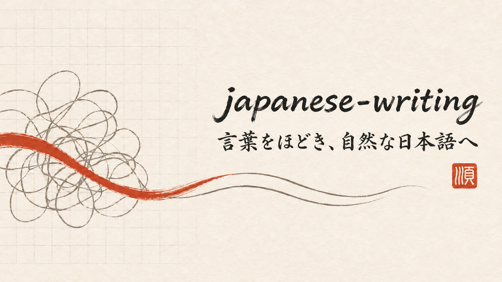

# japanese-writing



`japanese-writing` is a script-free Agent Skill for drafting, translating into, and polishing natural Japanese prose.

The rules come from [nanaism/yomiyasu](https://github.com/nanaism/yomiyasu) (MIT License), trimmed to one 53-line `SKILL.md` (2,390 characters, 5.6 KB) with no external scripts and no extra tool calls.

## Choosing between this skill and `nanaism/yomiyasu`

Use `japanese-writing` for everyday Japanese work in Claude Code, Codex CLI, and Antigravity (Gemini): emails, technical docs, articles, translations, and light edits where a short rule set is enough.

Use full [nanaism/yomiyasu](https://github.com/nanaism/yomiyasu) when you want its Python linter, semantic diff checks, and multi-step verification on formal Japanese deliverables.

## What the skill covers

- Keeps original claims, emphasis, modality (`〜してよい`, `〜できる`, `〜場合がある`, plain assertions), and tense intact, without inventing actors, causes, conditions, or numbers.
- Fixes long clauses stuck between subject and predicate, unpacks kanji stacks missing particles, replaces heavy nominalization with plain verbs, and removes literal English-to-Japanese calques.
- Sets document stance (`勧め`, `決まり`, `説明`) and polite or plain register up front, keeping past changes separate from current behavior.
- Replaces strained metaphorical verbs (`倒す`, `効く`, `溶かす`, `静かに壊れる`) and anthropomorphism with direct wording while keeping nuance and normal idioms.
- Removes redundant pause commas (`〜は、`, `〜を、`), hollow prefaces, em dashes, bold-label bullet clutter, and broken `**「太字」**` Markdown spans; writes auxiliary verbs and formal nouns (`こと`, `ため`) in hiragana without rewriting standard kanji terms.
- Leaves fiction, essays, dialogue, and promotional copy free from mechanical de-ornamentation.

## Installation

### All platforms (`npx skills`)

Works with Claude Code, Codex CLI, and Antigravity:

```bash
npx skills add aeopress/japanese-writing
```

### Claude Code

Install through the plugin marketplace:

```text
/plugin marketplace add aeopress/japanese-writing
/plugin install japanese-writing@japanese-writing
```

Or install the skill file manually:

```bash
git clone https://github.com/aeopress/japanese-writing /tmp/japanese-writing
mkdir -p ~/.claude/skills/japanese-writing
cp /tmp/japanese-writing/skills/japanese-writing/SKILL.md ~/.claude/skills/japanese-writing/SKILL.md
```

### Codex CLI

After cloning the repository into `/tmp/japanese-writing`:

```bash
mkdir -p ~/.codex/skills/japanese-writing
cp /tmp/japanese-writing/skills/japanese-writing/SKILL.md ~/.codex/skills/japanese-writing/SKILL.md
```

### Antigravity (Gemini / AGY)

Install as a global skill after cloning into `/tmp/japanese-writing`:

```bash
mkdir -p ~/.gemini/config/skills/japanese-writing
cp /tmp/japanese-writing/skills/japanese-writing/SKILL.md ~/.gemini/config/skills/japanese-writing/SKILL.md
```

Or copy the cloned repository into `~/.gemini/config/plugins/japanese-writing/` to load it via the root `plugin.json`.

## License and attribution

MIT License. See [LICENSE](LICENSE).

The refinement rules are adapted from [nanaism/yomiyasu](https://github.com/nanaism/yomiyasu) (Copyright (c) 2026 nanaism, MIT License).
